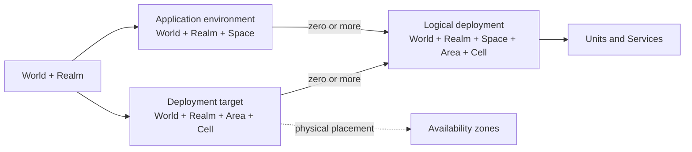

# Meridian Framework

Meridian is a framework for infrastructure identity and deployment topology. It gives application teams and operators a shared vocabulary for naming environments, placing deployments, and assigning state and dependencies to their owners.

<!-- meridian-quick-reference:start -->

## Identity dimensions

Use the relative order **Unit, World, Realm, Space, Area, Cell** when presenting these dimensions. An operation needs only the dimensions it consumes. Document the fixed enclosing scope whenever an identifier omits a dimension.

| Dimension | Meaning |
| --- | --- |
| **Unit** | A component such as an application backend, frontend, or infrastructure unit. |
| **World** | The product or system. |
| **Realm** | An operational purpose within a World, such as production or collaborative development. |
| **Space** | A logical application and state namespace within a World and Realm. |
| **Area** | An infrastructure area within a World and Realm that contains one or more Cells. |
| **Cell** | An installation or logical deployment target within an Area. Its final slug is opaque. |

A **Service** is a runtime service of a Unit, such as an API server or worker. One Unit can run several Services, and each Service can run several processes or replicas.

An **availability zone (AZ)** is a physical failure domain. A Cell may occupy one AZ or span several AZs or datacenters. Record provider zone names and shared physical risks separately from logical placement.

## Qualified identities

| Identity | Qualified tuple |
| --- | --- |
| Application environment | World + Realm + Space |
| Deployment target | World + Realm + Area + Cell |
| Logical deployment | World + Realm + Space + Area + Cell |

A deployment associates one environment with one target in the same World and Realm. A Space may deploy to several Cells, and a Cell may host several Spaces. Each environment has at most one logical deployment per Cell. Its Units, Services, nodes, replicas, and successive releases belong to that deployment.

### State ownership and Cell roles

Application state belongs to its World, Realm, and Space. Scope placement resources to their qualified target. A dependency that can safely isolate Spaces can serve the whole World and Realm as one logical instance.

The Cell slug is unique within its World, Realm, and Area and may repeat in another scope. Cell slugs can resemble provider or zone names. Resolve roles and physical placement from the target configuration. Master and replica responsibility, membership, and the descriptive role `cluster` are installation properties. Changing these properties preserves Cell identity. Each controller defines its supported roles and operations.

<!-- meridian-quick-reference:end -->

## Adopting Meridian

For offline use, copy the marked quick-reference block verbatim into one Markdown file in the consumer repository. Record the full Meridian commit and link back to this README. Route basic questions to the local copy and use this README for detailed guidance. When refreshing a copy, extract the block from the chosen commit and compare the copied text with that revision. Document project-specific slugs, inputs, identifier syntax, topology, and exceptions with their owners. The identity tuples describe scope. Each project defines its own configuration contract and each target system defines its separators, escaping, and length limits.

Use the recommendations below when introducing or explicitly migrating an identity. Before renaming an existing slug, account for consumers, named resources, and recovery procedures.

## Recommended slugs and readable names

Use the same lowercase slug for the same meaning across projects. Uppercase display abbreviations such as EDG and HST and the full names below explain the slugs. Extend the registry locally for product identities, tenants, sites, and exceptions. Projects define which values their parsers accept.

### Realm and Space slugs

| Realm (`OPS_REALM`) | Full name | Intended meaning | Recommended Spaces (`OPS_SPACE`) |
| --- | --- | --- | --- |
| `prd` | Production | Production operation. | `hq` (Headquarters) for the main production application environment. |
| `stg` | Staging | Pre-production acceptance with production-like configuration and, where explicitly permitted, real data. | — |
| `dev` | Development | Collaborative development and testing, normally delivered to a centrally reachable, shared environment. | `qa01`, `qa02`, … (Quality assurance 01, 02, …) for independently identified collaborative QA environments. |
| `lab` | Laboratory | Individual experimentation and development, normally local and private to one person. | `sbx` (Sandbox) for interactive development and experimentation. `tst` (Test) for dedicated automated-test state and fixtures. |

### Slugs shared across realms

The input names below show how existing `OPS_*` contracts can map to Meridian’s dimensions.

| Existing identity input | Recommended slug | Full name | Intended meaning |
| --- | --- | --- | --- |
| `OPS_UNIT` | `core` | Core | Main application backend component. |
| `OPS_UNIT` | `web` | Web | Web frontend component. |
| `OPS_UNIT` | `ops` | Operations | Operational tooling component, where independently identified. |
| `OPS_WORLD` | `<product>` | Registered product or system name | Stable project-owned product slug, such as `atlas` for Atlas. |
| `OPS_AREA` | `edg` | Edge | User-operated laptops, desktops, and workstations. |
| `OPS_AREA` | `cld` | Cloud | Cloud infrastructure area, with provider or regional scope defined by the project. |
| `OPS_AREA` | `dc` | Datacenter | Managed datacenter infrastructure area, with sites defined by the project. |
| `OPS_CELL` | `hst` | Host | Installation whose application processes execute directly in the host operating system. |
| `OPS_CELL` | `cmp` | Compose | Installation whose application services execute through a container Compose model. |
| `OPS_CELL` | `dkp` | Dokploy | Dokploy-managed installation with project-defined orchestration and placement. |
| `OPS_CELL` | `vgt` | Vagrant | Installation in one or more virtual machines managed through Vagrant. |
| `OPS_CELL` | `k8s` | Kubernetes | Kubernetes-based installation, with the actual cluster/namespace boundary explicitly defined by the project. |

Existing `OPS_SERVICE` contracts can use the following Service vocabulary.

| Recommended slug | Full name | Intended meaning |
| --- | --- | --- |
| `api` | Application programming interface | Runtime API service of a Unit. |
| `web` | Web | Runtime web-serving service of a Unit. |
| `worker` | Worker | Background processing service of a Unit. |
| `server` | Server | Generic server service where a more specific service identity is unnecessary or the project already uses this value. |

Unit `web` and Service `web` belong to different dimensions. Service names, availability-zone identifiers, release and execution metadata, image references, and addresses follow their owning contracts. Keep provider-defined AZ identifiers intact rather than replacing them with Cell slugs.

### Development and laboratory purposes

Use `dev` for collaborative development, such as centrally hosted QA Spaces. Use `lab` for individual work, typically with native processes, Compose, or local virtual machines. Starting an application locally creates a deployment association for that environment and target.

For local individual development across projects, use Realm `lab`, Area `edg`, Space `sbx` for interactive sandbox work and Space `tst` for automated tests when introducing or explicitly migrating those identities. Use a distinct Space for a distinct state namespace.

Choose the Realm by operational purpose, independently of the hosting technology. A private remote laboratory can use `lab`. A workstation can host a shared `dev` environment with explicit access and ownership boundaries. Use `stg` for pre-production acceptance.

### Placement mnemonics and uniqueness

Resolve the actual topology from configuration. The recommended Cell slugs give readers a naming mnemonic. Choose `hst` for a native application installation, including when supporting dependencies run in Compose. Choose `cmp` for a Compose-based application installation. VM nodes, container replicas, and Kubernetes nodes can all be members of one Cell.

A bare `hst`, `cmp` or `vgt` is appropriate when unique within World + Realm + Area. Two independently identified workstations in the same `(atlas, lab, edg)` scope need distinct stable Cell slugs, such as `hst-ws01` and `hst-ws02`. Repeating a suggested slug in another World, Realm or Area remains valid. A Cell can retain its identity as its implementation changes.

## State, placement and metadata

Scope application-owned databases, buckets, queues, and other application namespaces by World + Realm + Space, adding Unit or module distinctions where needed. The state identity persists across deployments of the same Space. Replication, independent physical copies and shared access require explicit data ownership and routing contracts.

Placement-owned resources use the qualified deployment target where needed, for example host management or infrastructure endpoints. Resources owned by a particular application deployment may need both Space and the qualified Cell target. Project-specific shortened context, lock or history keys must document their fixed scope and collision limits.

Moving data, switching endpoints, promoting a database, and changing public ingress each require an explicit operation and verification.

Release versions, build identifiers, image references, deployment execution tags and launch identifiers describe artifacts or executions of a logical deployment. A new launch or release preserves the deployment association even when its Services or replica counts change.

### Shared dependencies and Space isolation

Use one logical instance per World and Realm for each dependency that supports suitable Space isolation. Evaluate supported databases, schemas, tenants, namespaces, buckets, accounts and other native boundaries before declaring a dependency unshareable. Separate application data using a boundary the dependency enforces, such as a database, schema, tenant, key prefix, namespace, queue, or file volume. Shared infrastructure belongs to the Realm. For multi-Cell placements, document physical members, replication, endpoints, and reachability.

A dependency that cannot safely serve multiple Spaces normally belongs to the consuming service’s application deployment, with configuration, startup, shutdown, reset and recovery coordinated by that deployment. Before choosing a deployment-bound instance, an isolation exception, a replacement or removal, explain the unsupported sharing or isolation requirement and get explicit approval from the responsible project decision-maker. Evaluate the dependency’s native boundaries when Spaces need different configuration.

Runtime role determines ownership. A Temporal server can be Realm-owned infrastructure while a Temporal worker container belongs to the Core service deployment for its Space. An infrastructure component may own reusable tooling for deployment-bound processes while the consuming deployment coordinates their lifecycle.

Use the World–Realm scope in shared infrastructure names such as `atlas-lab-postgres`. Include Space and the consuming Service in deployment-bound process names such as `atlas-lab-sbx-core-worker`, following the project’s naming contract. Logical databases can remain `atlas_lab_sbx` and `atlas_lab_tst` regardless of Area or Cell. Verify isolation independently of resource names. Shared cluster-level roles or administrative credentials remain dependency/Realm-owned where applicable. Application data, authentication state, signing material and files remain Space-owned under their actual contracts. Do not reset shared roles or rotate shared credentials as a side effect of provisioning a Space.

Logical separation must enforce application and API isolation. Sharing a process accepts a common failure and maintenance boundary. Validate that each consumer selects its own database/tenant, endpoint and credentials, and that unauthorized cross-Space requests or tokens cannot access another Space's state. Enforce authorization on each boundary independently of namespaces and ports. Shared mail or object fixtures must be selected and removed by exact ownership rather than clearing a service globally.

Stopping, cleaning, resetting or recovering one Space must preserve shared dependencies and every other Space's resources. Shared-service maintenance must identify its affected Spaces and coordinate them. Keep Realm and Space configuration, state records, locks, and lifecycle operations distinct. Enforce each Space operation’s scope even when it can reach a shared dependency.

Back up the selected logical database, associated files, and required protected configuration as a consistent recovery unit. Restore into the Space’s logical resources. Recovering a shared physical volume is a Realm-wide operation that can affect every Space. Record the Realm roles, compatible versions, and other prerequisites the Space restore depends on, and verify whole-Realm recovery separately.

Verification should demonstrate simultaneous operation, rejection of unauthorized cross-Space access, exact fixture cleanup, preservation of neighboring Spaces during reset/recovery and persistence across authorized shared-service restarts. Projects own decisions about data recreation, reset exceptions, products, and ports.

## Examples from implementation

The examples use fictional World and site names. They describe identities and relationships derived from tracked configuration.

### Local development and Dokploy

World `atlas` configures Spaces `sbx` and `tst` in Realm `lab` on the host installation `(atlas, lab, edg, host)`. Both deployments run their own application processes and use a Realm-owned Compose project for shared dependencies. PostgreSQL provides separate application databases and owners. The shared Temporal server serves separate namespaces, and each Space runs its own worker. A test reset operates on `tst` resources and preserves `sbx` and shared dependencies.

The production configuration uses environment `(atlas, prd, hq)` and the Dokploy target `(atlas, prd, dc, dkp)`. Application resource names use the production Space. Each project owns the topology and dependency configuration behind its target.

### Shared QA, production Cells, and a Vagrant lab

World `orion` configures QA Spaces `qa01`, `qa02`, and `qa03` in Realm `dev` for one target, `(orion, dev, dc, r1a)`. Each Space has its own deployment identity.

In Realm `prd`, Space `hq` has targets `(orion, prd, dc, r1a)` and `(orion, prd, dc, r1b)`. Each installation contains application and database hosts. Inventory declares master and replica responsibilities, while the two Cell slugs stay stable through a role transition. Dependency recovery, writer fencing, and public ingress cutover require their own controls.

In Realm `lab`, the Vagrant inventory defines Cells `v1a` and `v1b` in Area `edg`. Each Cell contains separate application and database VMs. The lab deploy configuration selects Space `dbg`. VM provisioning and application deployment are distinct operations.

## Illustrative examples

### Native, Compose, and VM placements

For a personal laboratory, `(atlas, lab, edg, hst)` can identify a native host installation even when its dependencies run in Compose. Choose `cmp` when the application services themselves run through Compose. A target `(atlas, lab, edg, vgt)` can represent a Vagrant installation with several VM nodes.

Space `sbx` can deploy to both `hst` and `vgt` while retaining environment identity `(atlas, lab, sbx)`. Decide explicitly whether these deployments share or replicate state. Use distinct Spaces when the placements represent distinct application environments.

### Availability zones and quorum

Two Cells can occupy different physical failure domains. For example, Cell `east` in `room-a` can serve as master while Cell `west` in `room-b` follows as a replica. Both may host Space `hq`. Changing which Cell serves as master preserves both deployment identities.

One distributed Cell can also span several AZs and host one logical deployment of `hq`. With three voters, one per independent AZ, a majority quorum of two can survive one AZ loss. With five voters in five independent failure domains, a majority quorum of three can survive two domain losses. These examples assume a system designed for majority voting. Evaluate latency, correlated failures, fencing, storage durability, replication mode, and each service’s quorum rules independently.

## License

[MIT](LICENSE)
